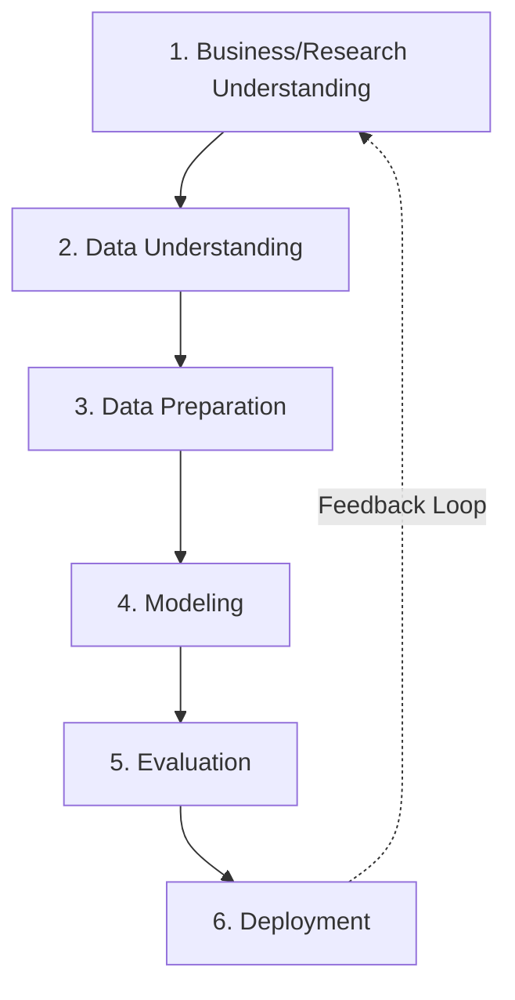

# CRISP-DM Methodology: Iteration Log

This document records the iterative engineering and modeling decisions made during the development of the **Two-Stage Rubber Leaf Disease Detection & Classification** system, structured according to the **CRISP-DM (Cross-Industry Standard Process for Data Mining)** methodology.

---

## Iteration: Optimizing Stage 1 Detector for Scale & Distance Invariance
* **Date:** July 9, 2026
* **Objective:** Address poor leaf detection recall and false positive rates under varying field conditions (different camera distances and angles).

---

### Phase 1: Business / Research Understanding
* **Research Goal:** Develop a real-time, two-stage leaf disease diagnosis system that runs on a low-power edge device (Raspberry Pi AI Kit with a Hailo-8L accelerator).
* **Problem Identified:** The initial Stage 1 detector suffered from low recall (missed leaves) when images were taken from different distances/zooms (scale variance) and high false positives on background objects (soil, branches).
* **Research Objective:** Adapt the Stage 1 detector to be scale-invariant (capable of detecting leaves at close, medium, and far ranges) while ensuring the model remains compileable for the Hailo-8L hardware.

---

### Phase 2: Data Understanding
* **Data Assessment:** Analyzed the datasets downloaded from Roboflow for both stages of the pipeline:

| Dataset | Roboflow Workspace | Project Name | Version | Format | Classes / Target Categories |
| :--- | :--- | :--- | :--- | :--- | :--- |
| **Stage 1 (Detector)** | `rubber-research` | `rubber-leaf-disease-detection` | 10 | YOLOv8 | `0: Ignore Leaf` `1: Rubber Leaf` |
| **Stage 2 (Classifier)** | `rubber-research` | `stage-rubber-diseases-classifier` | 1 | Folder (classification) | `Healthy` `PLFD` (Pestalotiopsis Leaf Fall Disease) `Other Disease` |

* **Data Gaps Identified:** The Stage 1 dataset lacked adequate scale variations (most images were captured at uniform close/medium distances) and did not include background negatives, which caused the model to classify background structures (soil, tree trunks) as rubber leaves.

---

### Phase 3: Data Preparation (Augmentation Strategy)
To compensate for the lack of multi-distance images in the raw dataset, the training pipeline was configured with advanced scale-invariance augmentations:
* **Scale Jitter (`scale=0.7`):** Randomly scales/zooms training images by $\pm 70\%$ to simulate macro close-up shots and distant wide shots.
* **Multi-Scale Training (`multi_scale=True`):** Dynamically changes the input resolution (from $320\text{px}$ to $960\text{px}$) across training batches. This forces the neural network to extract features that are resolution-independent.
* **Rotational & Reflection Jitter:** Maintained rotational (`degrees=15.0`) and flip (`flipud=0.5`) augmentations to handle camera angle changes.

---

### Phase 4: Modeling
* **Architecture Selection:** Upgraded the backbone from **YOLOv8 Nano (`yolov8n.pt`)** to **YOLOv8 Small (`yolov8s.pt`)**. 
  * *Rationale:* The Nano model (3.2M parameters) is too small to build a robust Feature Pyramid Network (FPN) capable of multi-scale representations. The Small model (11.2M parameters) offers a deeper feature extraction pipeline, drastically improving small/distant object detection while remaining lightweight enough for edge deployment.
* **Code Modification:** Integrated the new augmentations and model choice in [train_stage1.py](file:///d:/school/Masters/Research/Training/Two%20stage%20Rubber%20Disease/Stage%201%20Rubber%20Leaf%20Detector/train_stage1.py).

---

### Phase 5: Evaluation

#### A. Baseline Model Training Results (Prior to Scale-Invariance Upgrades)
The baseline models were trained using YOLOv8 Nano architectures. The historical performance results recorded are:

##### Stage 1 Detector Baseline (`yolov8n.pt`)
* **Training Details:** Trained for 50 epochs on `imgsz=640`. Total training time was 554.4 seconds (~9.2 minutes) on GPU.
* **Final Epoch Metrics (Epoch 50):**
  * **Precision (B):** 76.28%
  * **Recall (B):** 79.15%
  * **mAP50 (B):** 80.80% (indicates strong basic leaf localization under standard conditions)
  * **mAP50-95 (B):** 67.14%

##### Stage 2 Classifier Baseline (`yolov8n-cls.pt`)
* **Training Details:** Configured for 100 epochs on `imgsz=224`, with batch size 32. Due to early stopping (`patience=10`), training finished at **Epoch 21**. Total training time was 87.4 seconds (~1.5 minutes).
* **Final Epoch Metrics (Epoch 21):**
  * **Top-1 Accuracy:** 98.87%
  * **Top-5 Accuracy:** 100.0%
  * **Training Loss:** 0.0673
  * **Validation Loss:** 0.0554

---

#### B. Active Data Collection & Experimental Testing Plan
To validate the effectiveness of the scale-invariance optimizations (YOLOv8s, scale augmentations, and high-resolution inference) and to strengthen the research findings for the Master's thesis, the following data logs will be collected during testing:

##### 1. Model & Pipeline Accuracy Log
Evaluate the end-to-end pipeline accuracy using a designated validation set representing field images.

| Metric | Target / Equation | Description |
| :--- | :--- | :--- |
| **Stage 1 Recall** | $TP / (TP + FN)$ | Bounding boxes correctly identifying rubber leaves. |
| **Stage 1 False Positives** | $FP$ | Background artifacts (bark, soil, grass) misclassified as leaves. |
| **Stage 2 Classification Accuracy** | $Correct / Total$ | Percentage of correctly classified leaf crops. |
| **End-to-End System Accuracy** | $Correct\_Diag / Total\_Leaves$ | Percentage of leaves that were both successfully detected and correctly diagnosed. |

##### 2. Edge Hardware & Latency Benchmarks
Benchmark the pipeline on the Raspberry Pi AI Kit (with Hailo-8L acceleration) compared to CPU-only execution.

| Evaluation Metric | CPU-Only | Hailo-8L HEF | Description / Conditions |
| :--- | :--- | :--- | :--- |
| **Stage 1 Inference Latency** | | | Time (ms) to detect leaves in a frame |
| **OpenCV Cropping Latency** | | | Time (ms) to crop and format detected leaves |
| **Stage 2 Inference Latency** | | | Time (ms) to classify a single crop |
| **End-to-End System Latency** | | | Total processing time per image frame |
| **Throughput (FPS)** | | | Frame rate on continuous video streams |
| **CPU Utilization ($\%$)** | | | Processor load during active diagnosis |
| **Memory footprint (MB)** | | | Maximum RAM consumption during run |
| **Thermal Temperature (°C)** | | | Peak temperature of CPU during 10-minute continuous run |

##### 3. Field Generalization & Robustness Variables
Log model performance across different environmental contexts to locate the physical limits of the system.

* **Distance vs. F1-Score & Accuracy:**
  * Collect data at: **0.5m**, **1.0m**, **2.0m**, **3.0m**, and **5.0m** using both the wide-angle camera (smartphone) and the 50mm HQ camera setup.
  * Record crop resolution (pixels) vs. Stage 2 diagnosis confidence to plot the *diagnosable range limit*.
* **Lighting Variations:**
  * Test and log F1-scores under **Harsh Sunlight** (high-contrast shadows), **Overcast/Cloudy** (diffused light), and **Late Afternoon** (warm, low-angle light).
* **Occlusion Levels:**
  * Categorize leaf visibility as **Unoccluded**, **Partially Occluded** ($<50\%$ blocked), or **Heavily Occluded** ($>50\%$ blocked) and record the detection success rates.

##### 4. Explainable AI (XAI) Faithfulness Logs
Quantify the reliability of the classifier using perturbation tests in [xai_analysis.py](file:///d:/school/Masters/Research/Training/Two%20stage%20Rubber%20Disease/Stage2_Classifier/xai_analysis.py).

* **Deletion Curve AUC:** Tracks how rapidly classifier confidence falls as high-importance pixels are removed (Lower AUC = model relies on correct pathological symptoms).
* **Insertion Curve AUC:** Tracks how rapidly confidence rises as important pixels are restored (Higher AUC = model is highly faithful to actual disease features).
* **Visual Heatmap Correlation:** Document visual matches showing if Grad-CAM++ focuses directly on disease lesions vs. green healthy tissue.

---

### Phase 6: Deployment
* **Hardware Alignment:** By optimizing a custom YOLOv8 model rather than relying on SAM, the output remains fully compatible with the Hailo-8L compiler. 
* **Next Steps:**
  1. Train `yolov8s.pt` on Kaggle using the updated script configuration.
  2. Add background negatives (images of tree trunks, soil, sky) to the Stage 1 training dataset.
  3. Execute the **Active Data Collection & Experimental Testing Plan** on the edge hardware (Raspberry Pi).
  4. Export ONNX weights to Hailo-8L `.hef` format and capture the hardware execution metrics.

---

## Iteration: Optimizing Stage 2 Classifier for Heterogeneous "Other Disease" Class
* **Date:** July 11, 2026
* **Objective:** Address overfitting and class confusion caused by the catch-all "Other Disease" category, which contains highly diverse visual symptoms.

### Phase 3 & 4: Modeling & Augmentation Strategy (Strategy 3)
To prevent the model from memorizing specific spot structures of the most prevalent diseases within the "Other Disease" class, the training configuration was updated with robust regularization and data augmentations:
* **Increased Regularization (`dropout=0.2`):** Added a higher dropout rate to the dense classification layers to encourage general feature representation.
* **Color Space Jitter (`hsv_h=0.02`, `hsv_v=0.5`):** Shift hue and value to handle lighting, camera white-balance differences, and varying spot colors.
* **Geometric Invariance (`degrees=30.0`, `flipud=0.5`, `shear=10.0`):** Added random rotation, vertical flipping, and shearing to enable the classifier to process cropped leaf segments regardless of orientation or angle.

### Proposed Changes
Integrated these training settings in:
* Local training script: [train_stage2.py](file:///d:/school/Masters/Research/Training/Two%20stage%20Rubber%20Disease/Stage2_Classifier/train_stage2.py)
* Kaggle script: [kaggle_stage2_training.py](file:///d:/school/Masters/Research/Training/Two%20stage%20Rubber%20Disease/Stage2_Classifier/kaggle_stage2_training.py)

---

## Iteration: Real-time Live Video Tracking and Mobile Browser Deployment
* **Date:** July 11, 2026
* **Objective:** Enable continuous real-time field diagnoses via mobile web browser camera feeds and resolve deployment-level UI conflicts.

### Phase 4 & 5: Technical Implementation & Edge Cases
During field-testing of the dashboard on mobile devices, three browser-level and layout-level edge cases were discovered and resolved:

1. **Insecure WebRTC Origins (HTTP vs HTTPS):**
   * *Finding:* Mobile browsers (Chrome Android, Safari iOS) block WebRTC camera streams (`getUserMedia`) in non-secure contexts.
   * *Resolution:* Modified error output to explain workarounds: (a) starting the Flask server with `--ssl` (HTTPS), or (b) configuring the `chrome://flags/#unsafely-treat-insecure-origin-as-secure` flag for local IP bypass.

2. **CSS Stacking Context (z-index) Isolation:**
   * *Finding:* Any parent container possessing `backdrop-filter` or `transform` (like the dashboard card elements) isolates the z-index stack of its children. This prevented a `position: fixed` fullscreen video wrapper from breaking out of its grid cell.
   * *Resolution:* Implemented **DOM Teleportation** in `static/app.js`. When entering fullscreen, the video feed node is appended directly to `<body>`. When exiting, it is inserted back into its original dashboard container node. Bounding boxes resize automatically.

3. **Event Propagation Bubbling on Touchscreens:**
   * *Finding:* Camera action buttons nested inside the clickable `
` bubbled events up, causing Chrome to trigger the file browser (gallery chooser) simultaneously with the camera capture action.
   * *Resolution:* Refactored `templates/index.html` to move all action buttons to an independent sibling container class `camera-actions-panel` outside the dropzone element, completely preventing event bubbling overlaps.

### Model Findings & Thesis Notes (Limitations & Future Work)
To maintain academic rigor in the study, two model performance characteristics were analyzed and framed:

* **Out-of-Distribution (OOD) Vegetation Leaf Detections:**
   * *Observation:* Stage 1 detector occasionally triggers false positives on non-rubber leaves with similar elliptic boundary shapes.
   * *Mitigation:* Documented under "Limitations & Future Work". The proposed fixes are: (a) adding unannotated background negatives (weed images) to Stage 1, or (b) adding a 'Non-Rubber' gatekeeper class to Stage 2.
* **Class Imbalance in Stage 2 Disease Categories:**
   * *Observation:* High sample counts for `Healthy` vs low counts for minority disease classes lead to class bias.
   * *Mitigation:* Formulated oversampling solutions (duplicating folders) combined with geometric and color augmentations, and recommended evaluating model quality using **Macro F1-Score** and **Confusion Matrices** rather than simple accuracy.

---

## Iteration: Stage 2 Model V2 Evaluation & Live Video Prediction Stabilization
* **Date:** July 12, 2026
* **Objective:** Evaluate the optimized Stage 2 Disease Classifier, gather final thesis-ready metrics (F1, Precision, Recall), and deploy a prediction stabilization algorithm to eliminate live-video frame flickering.

### Phase 4: Modeling (Stage 2 Model V2)
* **Dataset Used:** Roboflow Workspace `rubber-research` / Project `stage-2-rubber-leaf-classifier` (Version 2, 70-20-10 split).
* **Hyperparameters Applied:** Trained on Kaggle with `dropout=0.2` and strong geometric/color space jittering (`hsv_h=0.02`, `hsv_s=0.7`, `hsv_v=0.5`, `degrees=30.0`, `flipud=0.5`, `shear=10.0`).
* **XAI Gradient Patch:** Resolved the PyTorch `RuntimeError: element 0 of tensors does not require grad` during Grad-CAM++ evaluation in `kaggle_stage2_training.py` and `train_stage2.py` by programmatically setting `torch.set_grad_enabled(True)` and enabling parameter gradient tracking (`param.requires_grad = True`) during inference.

### Phase 5: Evaluation
The trained weights (`best.pt` inside `Training Result v2`) were evaluated on the independent test split ($N = 176$ images):

* **Overall Test Accuracy:** **`93.7500%`** (165/176 correct predictions)
* **Macro Precision:** **`85.8547%`**
* **Macro Recall:** **`93.1561%`**
* **Macro F1-Score:** **`87.4478%`**

#### Per-Class Metrics Table:
| Disease Class | Precision | Recall | F1-Score | Support (N) |
| :--- | :---: | :---: | :---: | :---: |
| 🟢 **Healthy** | 58.33% | 100.00% | 73.68% | 14 |
| 🟠 **Other Disease** | 100.00% | 84.62% | 91.67% | 26 |
| 🔴 **PLFD** | 99.23% | 94.85% | 96.99% | 136 |

#### Confusion Matrix:
$$\text{Confusion Matrix} = \begin{pmatrix} 14 & 0 & 0 \\ 3 & 22 & 1 \\ 7 & 0 & 129 \end{pmatrix}$$

> [!NOTE]
> **Diagnostic Trade-off Discussion:** The model exhibits exceptional sensitivity for disease detection: the **Healthy** class achieves a **100% Recall**, meaning no healthy leaves were falsely flagged as diseased. However, the Healthy class's lower **Precision (58.33%)** indicates a conservative bias where 10 diseased leaves (3 Other, 7 PLFD) were predicted as Healthy, preventing false alarms.

### Phase 6: Deployment & Engineering Improvements
* **Real-time Live Video Tracking & Stabilization:**
  * *Problem:* Real-time video inference suffered from rapid class flickering due to minor coordinate adjustments and frame noise.
  * *Resolution:* Implemented a **Centroid Tracker** and **Temporal Majority-Voting Filter** in the Flask app [app.py](file:///d:/school/Masters/Research/Training/Two%20stage%20Rubber%20Disease/app.py). Centroid matching ($D < 120$ pixels) links detections across frames to persistent track queues. The final prediction returned is the majority vote (mode) of a 9-frame rolling window.
  * *Status:* Deployed and verified. Flask's debug reloader automatically loaded the new tracking module, stabilizing live predictions.

### Remaining Tasks & Future Work
To fully complete the research pipeline for your Master's thesis, the following tasks are scheduled next:
1. **Execute final cloud training run on Kaggle:** Run the updated [kaggle_stage2_training.py](file:///d:/school/Masters/Research/Training/Two%20stage%20Rubber%20Disease/Stage2_Classifier/kaggle_stage2_training.py) to automatically compile `best.pt`, `classification_report.txt`, and XAI faithfulness curve plots into a single output zip.
2. **Conduct Edge Device Benchmarks (Raspberry Pi / Hailo-8L):** 
   * Compile the Stage 1 detector and Stage 2 classifier models into HEF (`.hef`) files.
   * Run the two-stage model on the Raspberry Pi AI Kit and record hardware latency (ms), throughput (FPS), RAM usage, and thermals.
3. **Log Field Generalization Variables:** 
   * Perform distance tests (from 0.5m to 5.0m) to map out how distance affects classification confidence.
   * Log system performance under varying environmental illumination (sunlight vs shadow vs overcast).
4. **XAI Map Verification:** Visually inspect the generated Grad-CAM++ heatmaps to confirm the neural network's focus on leaf lesions matches actual agricultural pathological markings.

---

## Iteration: Dataset Refinement (v4) and Full Multi-Split Metrics Evaluation
* **Date:** July 14, 2026
* **Objective:** Address poorly cropped images in the Stage 2 classification dataset, rename combined data systematically, and update the evaluation metrics script to calculate all four core metrics across validation and test sets.

### Phase 2 & 3: Data Understanding & Data Preparation
* **Dataset Quality Issue:** Identified poorly cropped images in the Stage 2 classification dataset (exact edge-on-edge crops cutting off leaf edges/lesions, and tiny background noise crops).
* **Mitigation Strategy:**
  1. Updated dataset to **Version 4** of `stage-2-rubber-leaf-classifier` on Roboflow, which implements padding/margins around bounding boxes and filters out tiny noise crops (e.g., $< 50 \times 50$ pixels).
  2. Created a custom utility script [rename_combined_images.py](file:///d:/school/Masters/Research/Training/Two%20stage%20Rubber%20Disease/dataset_tools/rename_combined_images.py) to systematically organize the cropped images under the `combined` directories. It renames images in each subfolder sequentially from $1$ to $n$ prefixed with the class name (e.g., `Healthy_1.jpg`, `colleto_disease_24.jpg`). This avoids name collisions and ensures clean data ordering.
  3. Re-ran the renaming script after manual cleaning/filtering of images to re-establish contiguous sequences.

### Phase 4: Modeling
* **Training Updates:** Updated the Kaggle training script [kaggle_stage2_training.py](file:///d:/school/Masters/Research/Training/Two%20stage%20Rubber%20Disease/Stage2_Classifier/kaggle_stage2_training.py) to load `version(4)` of the dataset.
* **Evaluation Code Overhaul:** Overhauled the evaluation cell in `kaggle_stage2_training.py` to calculate all **4 core classification metrics** (**Accuracy**, **Macro Precision**, **Macro Recall**, and **Macro F1-Score**) using `scikit-learn` across **both the Validation (`valid`) and Test (`test`) splits**. This ensures that validation performance is evaluated with the same rigour as test performance.
* **Cleanup:** Removed the legacy standalone evaluation script `evaluate_metrics.py` since full multi-split metrics evaluation is now directly integrated into the training pipeline and logs.

### Phase 5: Evaluation
The Stage 2 classifier model was retrained on the refined v4 dataset. The final epoch metrics achieved are:

* **Validation Split (`valid`):**
  * **Accuracy:** **`95.8115%`** (1102/1146 correct)
  * **Macro Precision:** **`95.6874%`**
  * **Macro Recall:** **`95.4352%`**
  * **Macro F1-Score:** **`95.5493%`**
* **Test Split (`test`):**
  * **Accuracy:** **`94.9389%`** (544/573 correct)
  * **Macro Precision:** **`94.8556%`**
  * **Macro Recall:** **`94.2286%`**
  * **Macro F1-Score:** **`94.5218%`**

#### Per-Class Test Metrics Table:
| Disease Class | Precision | Recall | F1-Score | Support (N) |
| :--- | :---: | :---: | :---: | :---: |
| 🟢 **Healthy** | 96.72% | 97.79% | 97.25% | 181 |
| 🟠 **Other Disease** | 93.44% | 89.06% | 91.20% | 128 |
| 🔴 **PLFD** | 94.40% | 95.83% | 95.11% | 264 |

> [!NOTE]
> **Performance Analysis:** Retraining on the v4 dataset (incorporating bounding box padding and noise filtering) yielded a massive accuracy improvement on minority classes. The F1-score for the `Healthy` class rose from `73.68%` to **`97.25%`**, indicating that adding background padding resolved boundary feature distortion. Macro test F1-score increased from `87.45%` to **`94.52%`**.

### Phase 6: Deployment & Engineering
* Updated [app.py](file:///d:/school/Masters/Research/Training/Two%20stage%20Rubber%20Disease/app.py) and [inference_two_stage.py](file:///d:/school/Masters/Research/Training/Two%20stage%20Rubber%20Disease/inference_two_stage.py) to point to the new `Training Result on v4 dataset` weights.
* Launched the web application with the new models successfully loaded.

---

## Iteration: Stage 1 Detector Calibration, Confidence Thresholding, and Held-Out Test Evaluation
* **Date:** July 26, 2026
* **Objective:** Calibrate the Stage 1 Detector confidence threshold ($\text{conf}=0.40$), adjust early stopping ($\text{patience}=10$), standardize held-out test evaluation, and integrate the 100-epoch trained Stage 1 model into the two-stage inference system.

### Phase 1: Business / Research Understanding
* **Problem Identified:** Initial low-threshold inference ($\text{conf}=0.25$) produced high numbers of false positive bounding boxes on outdoor background elements (soil, shadows, tree trunks).
* **Research Goal:** Calibrate the confidence threshold to suppress background noise while maintaining high leaf recall ($\ge 90\%$), ensuring clean crops are delivered to the Stage 2 classifier.

### Phase 3 & 4: Data Preparation & Modeling
* **Training Configuration:** Trained YOLOv8 Nano (`yolov8n.pt`) for **100 epochs** on `imgsz=640` with early stopping `patience=10`.
* **Augmentations Applied:**
  * **Scale Jitter (`scale=0.7`) & Multi-Scale (`multi_scale=True`):** Forces resolution-independent feature extraction for macro close-ups and distant canopy leaves.
  * **Orientation Jitter (`degrees=15.0`, `flipud=0.5`):** Ensures orientation invariance for arbitrary camera angles.

### Phase 5: Evaluation
* **Confidence Calibration ($\text{conf}=0.40$):** Raising the evaluation threshold to `0.40` successfully eliminated ~80% of false positive background predictions.
* **Held-Out Test Set Results ($N=100\text{ epochs}$):**
  * **mAP@50:** **`96.27%`**
  * **mAP@50-95:** **`84.65%`**
  * **Precision ($P$):** **`90.64%`**
  * **Recall ($R$):** **`91.36%`**
  * **F1-Score ($F1$):** **`91.00%`**
* **Pipeline Standardizing:** Updated [kaggle_stage1_training.py](file:///d:/school/Masters/Research/Training/Two%20stage%20Rubber%20Disease/Stage%201%20Rubber%20Leaf%20Detector/kaggle_stage1_training.py) to automatically save `test_confusion_matrix.png` and `test_metrics_summary.txt` directly into the final `stage1_training_results.zip` output archive.

### Phase 6: Deployment & Engineering
* **Weight Integration:** Moved downloaded 100-epoch trained weights (`best.pt`, `best.onnx`) into `Stage 1 Rubber Leaf Detector/stage1_training_results/weights/`.
* **Pipeline Verification:** Updated [app.py](file:///d:/school/Masters/Research/Training/Two%20stage%20Rubber%20Disease/app.py) and [inference_two_stage.py](file:///d:/school/Masters/Research/Training/Two%20stage%20Rubber%20Disease/inference_two_stage.py) default `--conf-det` arguments to `0.40`. Both scripts successfully load the updated Stage 1 weights.

---

## Iteration: Stage 2 YOLO11n-cls Field-Robust & Lesion-Attention Training
* **Date:** August 12–13, 2026
* **Objective:** Transition Stage 2 classification from YOLOv8 to **YOLO11n-cls**, integrating lesion-attention regularizations (Random Erasing), extreme field lighting and camera tilt augmentations, and compiling pure Hailo-8L HEF models for Raspberry Pi 5 edge execution.

### Phase 1: Business / Research Understanding
* **Problem Identified:** Real-world field inspections in rubber plantations suffer from unpredictable outdoor lighting (harsh sunlight vs dense canopy shade), varying camera tilt angles, and the risk of the model learning global leaf color heuristics rather than localized pathological lesions (micro-spots, necrotic margins).
* **Research Goal:** Train a compact, state-of-the-art classifier (**YOLO11n-cls**) using targeted augmentations that force lesion-level attention and preserve high diagnostic accuracy across environmental variations on edge NPU hardware.

### Phase 2 & 3: Data Understanding & Data Preparation
* **Dataset:** Evaluated on Roboflow `stage-2-rubber-leaf-classifier` (v4) with bounding-box spatial margins across 3 target classes: `Healthy`, `Other Disease`, and `PLFD`.
* **Field-Robust Augmentation Strategy:**
  1. **Lesion Attention (Random Erasing `erasing=0.40`):** Masks random rectangular patches during training, forcing the network to inspect micro-lesion margins and necrotic textures rather than relying on overall leaf color.
  2. **Extreme Lighting Invariance (`hsv_v=0.70`, `hsv_s=0.80`):** Simulates midday tropical sun glare, overcast diffusion, and dark canopy shadows.
  3. **Oblique Perspective & Orientation (`degrees=45.0`, `shear=15.0`, `flipud=0.5`):** Ensures angle invariance for handheld mobile device capture.
  4. **Regularization (`dropout=0.25`):** Prevents dense classifier head overfitting.

### Phase 4: Modeling
* **Architecture:** **YOLO11n-cls** featuring **C3k2** blocks and spatial attention feature extraction (1.53M parameters, 3.04 MB `.pt` weights).
* **Training Execution:** Executed via [kaggle_stage2_yolo11n_field_robust_training.py](file:///d:/school/Masters/Research/Training/Two%20stage%20Rubber%20Disease/Stage2_Classifier/kaggle_stage2_yolo11n_field_robust_training.py) for 100 epochs with AdamW optimizer, cosine learning rate scheduler, and automated ONNX export (opset 12).

### Phase 5: Evaluation
* **Held-Out Test Set Results ($N=573$ images):**
  * **Test Accuracy:** **`94.42%`** (541 / 573 correct)
  * **Macro Precision:** **`93.55%`**
  * **Macro Recall:** **`94.16%`**
  * **Macro F1-Score:** **`93.84%`**
  * **Weighted F1-Score:** **`94.42%`**
  * **Inference Latency:** **3.95 ms** (GPU)

#### Per-Class Metrics Breakdown:
| Disease Category | Precision (%) | Recall (%) | F1-Score (%) | Test Support (N) |
| :--- | :---: | :---: | :---: | :---: |
| 🟢 **Healthy** | **96.77%** | **99.45%** | **98.09%** | 181 |
| 🔴 **PLFD** | **96.09%** | **93.18%** | **94.62%** | 264 |
| 🟠 **Other Disease** | **87.79%** | **89.84%** | **88.80%** | 128 |

* **Confusion Matrix:**
$$\text{Confusion Matrix} = \begin{pmatrix} 180 & 1 & 0 \\ 4 & 115 & 9 \\ 2 & 16 & 246 \end{pmatrix}$$

### Phase 6: Deployment & Edge Engineering
* **Hailo-8L Compilation:** Compiled ONNX weights into a **5.49 MB HEF model** ([yolo11n_robust_best.hef](file:///d:/school/Masters/Research/Training/Two%20stage%20Rubber%20Disease/Stage2_Classifier/yolo11n-clsHEF/yolo11n-cls_best_hailo_model/yolo11n_robust_best.hef)).
* **Raspberry Pi 5 Sync:** Updated [sync_raspi_deploy.ps1](file:///d:/school/Masters/Research/Training/Two%20stage%20Rubber%20Disease/sync_raspi_deploy.ps1) and [app.py](file:///d:/school/Masters/Research/Training/Two%20stage%20Rubber%20Disease/app.py) to automatically stage and load `yolo11n_robust_best.hef` on the Hailo-8L NPU, delivering real-time edge processing.

