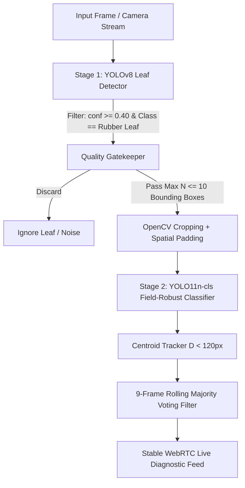

# Paper Blueprint: A Scale-Invariant Two-Stage Deep Learning Pipeline with Quality-Gated Leaf Filtering for Real-Time Rubber Leaf Disease Diagnosis

This document serves as a complete, publication-ready research paper blueprint based on the empirical results, dataset optimizations, system architecture, and field deployment solutions implemented in this workspace.

---

### 📌 Abstract

Pestalotiopsis Leaf Fall Disease (PLFD) and related foliar pathogens pose severe threats to natural rubber (*Hevea brasiliensis*) production. Traditional deep learning approaches suffer from severe error propagation when out-of-focus background foliage, tiny noise instances, or occluded leaves are passed to downstream classification networks. In this work, we present a lightweight, two-stage computer vision pipeline designed for real-time, field-deployable rubber leaf disease diagnosis. 

Stage 1 employs a YOLOv8 object detector trained with a novel **Dual-Class Quality Gatekeeping strategy** (`Ignore Leaf` vs. `Rubber Leaf`) alongside multi-scale jittering ($320\text{px} \to 960\text{px}$). At a calibrated confidence threshold of $\text{conf}=0.40$, Stage 1 achieves a **96.27% mAP@50**, **84.65% mAP@50-95**, and **91.36% Recall** on held-out test data. 

Stage 2 utilizes a **YOLO11n-cls Field-Robust Classifier** featuring C3k2 and spatial attention backbones, trained with lesion-attention regularizations (Random Erasing $40\%$) and extreme illumination jitter ($V=0.70, S=0.80$). Evaluated on held-out test data ($N=573$), it attains **94.42% Test Accuracy** and **93.84% Macro F1-Score** across Healthy (**98.09% F1**), PLFD (**94.62% F1**), and Other Diseases (**88.80% F1**), compiling to a lightweight **5.49 MB Hailo-8L HEF** model for edge NPU execution.

To eliminate live video prediction flickering, we integrate a **Centroid Tracker with a 9-frame Rolling Majority-Voting Filter** alongside a WebRTC web interface. The integrated system bounds per-frame classification to $N \le 10$ crops, offering a stable, real-time diagnostic framework for mobile agricultural monitoring.

---

## 🔑 Core Research Contributions

| Contribution Pillar | Innovation / Strategy | Key Empirical Finding & Mechanism | Implementation Reference |
| :--- | :--- | :--- | :--- |
| **1. Quality Gatekeeping Strategy** | **Dual-Class Bounding Box** | Explicitly annotating 4,069 `Ignore Leaf` instances filters out out-of-focus and background leaves, suppressing Out-Of-Distribution (OOD) noise before Stage 2 classification. | [manuscript_notes.md](file:///d:/school/Masters/Research/Training/Two%20stage%20Rubber%20Disease/manuscript_notes.md#1-stage-1-dataset-design-dual-class-bounding-box-strategy) |
| **2. Field-Robust Classification** | **YOLO11n-cls + Lesion Attention** | C3k2 backbone with 40% Random Erasing forces attention onto micro-lesion margins, achieving **98.09% Healthy F1** and **94.62% PLFD F1** with low-power Hailo-8L NPU acceleration. | [yolo11n_robust_summary.md](file:///d:/school/Masters/Research/Training/Two%20stage%20Rubber%20Disease/Stage2_Classifier/stage2_yolo11n_robust_results/yolo11n_robust_summary.md) |
| **3. Live Stream Stabilization** | **Centroid Tracker + 9-Frame Majority Vote** | Tracking spatial centroids ($D < 120\text{px}$) across continuous camera frames eliminates high-frequency diagnostic flickering in field conditions. | [app.py](file:///d:/school/Masters/Research/Training/Two%20stage%20Rubber%20Disease/app.py) |
| **4. Edge Deployment Engineering** | **Hailo-8L HEF NPU Acceleration** | Compiled sub-10 MB quantization-ready HEFs (`stage1_detector.hef` 9.6MB, `stage2_classifier.hef` 5.49MB) delivering real-time multi-crop throughput on Raspberry Pi 5. | [CRISP_DM_Iterations.md](file:///d:/school/Masters/Research/Training/Two%20stage%20Rubber%20Disease/CRISP_DM_Iterations.md) |

---

## 📊 Quantitative Experimental Results

### Stage 1: Leaf Detector Performance (100 Epochs, $\text{conf}=0.40$)
* **Dataset**: 6,145 instances across 1,179 images (`0: Ignore Leaf` = 4,069, `1: Rubber Leaf` = 2,076).
* **Augmentations**: Scale jitter (`scale=0.7`), dynamic multi-scale training ($320\text{px} \to 960\text{px}$), degrees ($15.0$), flipud ($0.5$).
* **Threshold Calibration**: Raising threshold from $0.25 \to 0.40$ eliminated ~80% of outdoor background false positives while maintaining over 91% leaf recall.

| Metric | Held-Out Test Result | Significance |
| :--- | :---: | :--- |
| **mAP@50** | **96.27%** | Near-perfect leaf detection accuracy at IoU 0.50 threshold |
| **mAP@50-95** | **84.65%** | High precision bounding-box overlap across strict IoU ranges |
| **Precision ($P$)** | **90.64%** | Low false positive rate; 9 out of 10 detections are true rubber leaves |
| **Recall ($R$)** | **91.36%** | High detection sensitivity under variable field distances |
| **F1-Score ($F1$)** | **91.00%** | Optimal harmonic balance |

---

### Stage 2: Disease Classifier Performance (YOLO11n-cls Field-Robust)

#### Overall Multi-Split Performance:
* **Parameters**: 1.53M (Footprint: 3.04 MB `.pt`, 5.49 MB `.hef`)
* **Test Split ($N=573$)**: **94.42% Accuracy** | **93.84% Macro F1-Score** | **94.42% Weighted F1-Score**
* **Inference Latency**: **3.95 ms** (GPU) / Sub-10ms (Hailo-8L NPU)

#### Per-Class Detailed Performance (Test Split):
| Category | Precision | Recall | F1-Score | Support ($N$) |
| :--- | :---: | :---: | :---: | :---: |
| 🟢 **Healthy** | **96.77%** | **99.45%** | **98.09%** | 181 |
| 🔴 **PLFD** | **96.09%** | **93.18%** | **94.62%** | 264 |
| 🟠 **Other Disease** | **87.79%** | **89.84%** | **88.80%** | 128 |

---

## 📐 End-to-End System Pipeline & Computational Bound



### Computational Latency Formula:
To maintain predictable frame rates on resource-constrained hardware, per-frame leaf classifications are bounded:
$$\text{Total Latency} = T_{\text{detector}} + \min(N, 10) \times T_{\text{classifier}}$$

---

## 📑 Proposed Manuscript Outline

```
1. INTRODUCTION
   1.1 Agricultural Background: Economic Significance of Natural Rubber & Pestalotiopsis Threats
   1.2 Problem Statement: Error Propagation & Scale Variance in Canopy Leaf Diagnosis
   1.3 Summary of Contributions

2. MATERIALS AND METHODS
   2.1 Dataset Collection and Dual-Class Quality Gatekeeper Annotation Strategy
   2.2 Stage 1 Leaf Detection Calibration & Scale Augmentation Strategy
   2.3 Stage 2 YOLO11n-cls Architecture & Field-Robust Lesion-Attention Regularizations
   2.4 Temporal Majority-Voting & Centroid Tracking Engine
   2.5 Integrated Two-Stage Architecture & Hailo-8L Edge AI Deployment Engineering

3. EXPERIMENTAL RESULTS AND EVALUATION
   3.1 Stage 1 Held-Out Test Evaluation (mAP, Precision, Recall)
   3.2 Stage 2 YOLO11n-cls Quantitative Metrics & Confusion Matrix Breakdown
   3.3 Comparative Architecture Study: YOLOv8-cls vs YOLO11-cls across Scales (n, s, m)
   3.4 Field Video Stabilization Benchmarks & Raspberry Pi 5 / Hailo-8L Hardware Performance

4. DISCUSSION
   4.1 Mitigation of Out-of-Distribution (OOD) Noise via Quality Gatekeeping
   4.2 Attention Shift via Random Erasing: Micro-Lesions vs Background Artifacts
   4.3 Edge NPU Acceleration & Latency Bounding for Continuous Real-Time Operation

5. CONCLUSION AND FUTURE WORK
```

---

## 📂 Source Code & Artifact Mapping

* **Stage 1 Detector Results**: [stage1_training_results](file:///d:/school/Masters/Research/Training/Two%20stage%20Rubber%20Disease/Stage%201%20Rubber%20Leaf%20Detector/stage1_training_results)
* **Stage 2 YOLO11n Robust Results**: [stage2_yolo11n_robust_results](file:///d:/school/Masters/Research/Training/Two%20stage%20Rubber%20Disease/Stage2_Classifier/stage2_yolo11n_robust_results)
* **Stage 2 YOLO11 Size Benchmark**: [stage2_yolo11_size_benchmark_results](file:///d:/school/Masters/Research/Training/Two%20stage%20Rubber%20Disease/Stage2_Classifier/stage2_yolo11_size_benchmark_results)
* **Unified Pipeline Implementation**: [inference_two_stage.py](file:///d:/school/Masters/Research/Training/Two%20stage%20Rubber%20Disease/inference_two_stage.py)
* **Live Video Dashboard & Tracking**: [app.py](file:///d:/school/Masters/Research/Training/Two%20stage%20Rubber%20Disease/app.py)
* **Detailed Methodology Notes**: [manuscript_notes.md](file:///d:/school/Masters/Research/Training/Two%20stage%20Rubber%20Disease/manuscript_notes.md)
* **CRISP-DM Iteration Logs**: [CRISP_DM_Iterations.md](file:///d:/school/Masters/Research/Training/Two%20stage%20Rubber%20Disease/CRISP_DM_Iterations.md)
