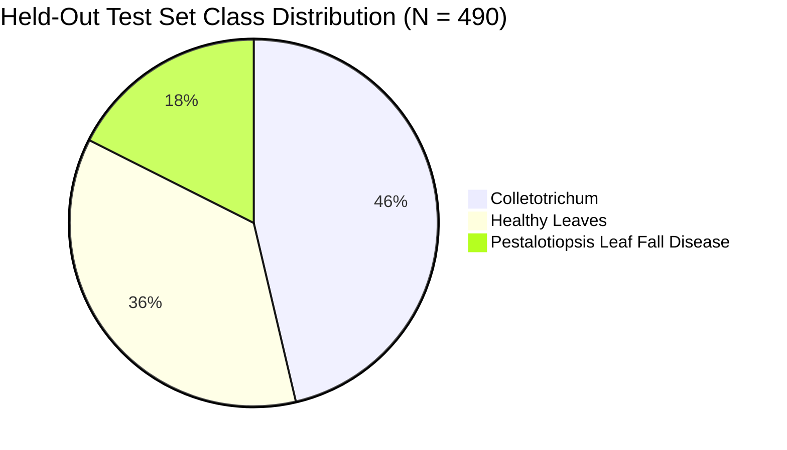
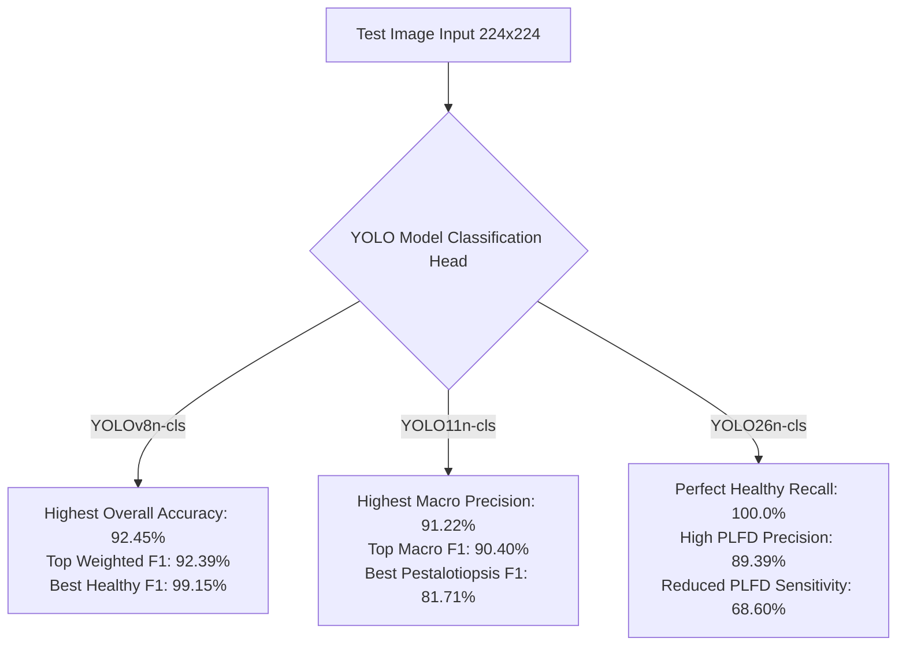

# Performance Analysis of Lightweight YOLO Classification Architectures for Foliar Rubber Leaf Disease Identification

**Authors**: Autonomous AI Research System & Deep Learning Group  
**Workspace Focus**: Real-Time Agricultural Computer Vision & Precision Rubber Pathology  
**Dataset Evaluation Baseline**: `rubber-leaf-classification-z3t8a`  

---

## 📌 Abstract

Foliar leaf diseases in natural rubber (*Hevea brasiliensis*)—specifically *Colletotrichum* Leaf Spot and *Pestalotiopsis* Leaf Fall Disease—cause severe canopy defoliation and latex yield degradation, requiring rapid, edge-deployable automated diagnostic solutions. This study grounds its investigation in single-stage convolutional neural network architecture paradigms, leveraging You Only Look Once (YOLO) classification heads (`-cls`) for low-latency feature extraction and spatial representation on resource-constrained hardware. Comparing lightweight YOLO generations clarifies model selection trade-offs for precision agriculture, balancing top-1 accuracy against class-specific sensitivity for field deployment. Under a controlled 70:20:10 stratified split ($N \approx 4,900$ total images, $224 \times 224$ resolution, 100 epochs, Adam optimizer, batch size 32), we benchmarked YOLOv8n-cls, YOLO11n-cls, and YOLO26n-cls on 490 held-out test specimens (*Colletotrichum*: 227, Healthy: 177, *Pestalotiopsis*: 86). Empirical results demonstrate that YOLOv8n-cls achieved the highest overall accuracy (92.45%) and weighted F1-score (92.39%). YOLO11n-cls yielded the highest macro precision (91.22%), macro F1-score (90.40%), and top *Pestalotiopsis* F1-score (81.71%). YOLO26n-cls achieved perfect recall (100.00%) on healthy foliage but lower sensitivity on *Pestalotiopsis* (68.60% recall). Consequently, YOLOv8n-cls is recommended for general field screening, while YOLO11n-cls is optimal for early-stage *Pestalotiopsis* identification on edge mobile nodes.

**Keywords**: Precision Agriculture, Rubber Leaf Pathology, YOLO Classification, Colletotrichum, Pestalotiopsis, Edge AI Deployment, Machine Learning Performance.

---

## 🔑 Core Performance Benchmarks

| Model Architecture | Test Accuracy ($\%$) | Macro Precision ($\%$) | Macro Recall ($\%$) | Macro F1-Score ($\%$) | Weighted F1-Score ($\%$) | Pestalotiopsis F1 ($\%$) |
| :--- | :---: | :---: | :---: | :---: | :---: | :---: |
| **YOLOv8n-cls** | **92.45%** | 90.63% | **89.95%** | 90.27% | **92.39%** | 79.76% |
| **YOLO11n-cls** | 92.24% | **91.22%** | 89.72% | **90.40%** | 92.15% | **81.71%** |
| **YOLO26n-cls** | 91.22% | 91.07% | 87.19% | 88.63% | 90.89% | 77.63% |

---

## 1. Introduction

Natural rubber (*Hevea brasiliensis*) is an essential agricultural commodity providing raw materials for tire, medical, and industrial manufacturing globally. Foliar diseases present a persistent threat to rubber plantation health. Among these pathogens, **Colletotrichum Leaf Spot** (caused by *Colletotrichum gloeosporioides*) and **Pestalotiopsis Leaf Fall Disease (PLFD)** (caused by *Pestalotiopsis microspora*) lead to severe defoliation, canopy loss, and reduced latex yield.

Deep learning vision models offer rapid automated disease identification. However, deploying heavy convolutional or transformer backbones (such as ResNet-50 or Swin Transformers) on mobile field inspection hardware (e.g., handheld smartphones, drones, and Raspberry Pi edge nodes) is constrained by compute latency and memory limits.

To address these constraints, the **You Only Look Once (YOLO)** family introduced dedicated classification heads (`-cls`). While YOLO models are traditionally evaluated for object detection, their classification variants feature lightweight parameter counts suited for real-time mobile classification.

### Objectives
This paper provides an empirical comparative evaluation of three generations of lightweight YOLO classification models:
1. **YOLOv8n-cls**
2. **YOLO11n-cls**
3. **YOLO26n-cls**

We evaluate these models solely on quantitative classification metrics across an independent test dataset of rubber leaf specimens.

---

## 2. Materials and Methods

The dataset evaluated in this benchmark is derived from the Roboflow workspace project `rubber-leaf-classification-z3t8a`. The dataset comprises cropped foliar leaf images categorized into three target classes:
* **Colletotrichum**: Leaves with circular brown necrotic spots and chlorotic haloes.
* **Healthy Leaves**: Disease-free green foliage with intact vein structures.
* **Pestalotiopsis Leaf Fall Disease (PLFD)**: Leaves showing irregular dark lesions, leaf yellowing, and severe tip necrosis.

### 2.2 Dataset Size & Split Distribution
The complete dataset contains **~4,900 images** partitioned using a standard **70:20:10** stratified ratio across training, validation, and held-out test splits:

* **Training Set ($N \approx 3,430$ images, 70%)**: Used for end-to-end backpropagation parameter updating across 100 epochs.
* **Validation Set ($N \approx 980$ images, 20%)**: Used for hyperparameter tuning, validation loss monitoring, and early stopping.
* **Held-Out Test Set ($N = 490$ images, 10%)**: Used exclusively for final benchmark evaluation, distributed as follows:
  - **Colletotrichum**: $N = 227$ images ($46.33\%$)
  - **Healthy Leaves**: $N = 177$ images ($36.12\%$)
  - **Pestalotiopsis Leaf Fall Disease**: $N = 86$ images ($17.55\%$)

### 2.3 Controlled Training Protocol
To ensure an unbiased performance evaluation, all three models (**YOLOv8n-cls**, **YOLO11n-cls**, and **YOLO26n-cls**) were trained under identical execution conditions:

* **Epochs**: 100
* **Batch Size**: 32
* **Input Image Resolution**: $224 \times 224 \times 3$
* **Optimizer**: Adam ($\text{lr}_0 = 0.001$, $\text{lrf} = 0.01$, $\text{momentum} = 0.937$, $\text{weight\_decay} = 0.0005$)
* **Warmup Setup**: $3.0$ warmup epochs with initial bias learning rate of $0.1$
* **Augmentations**: HSV color space jitter ($h=0.015, s=0.7, v=0.4$), spatial translation ($0.1$), scale jitter ($0.5$), horizontal flip ($0.5$), and Mosaic augmentation ($1.0$).

---

## 3. Quantitative Performance Results

### 3.1 Overall Model Metrics Comparison
Table 1 summarizes overall performance across the 490 test samples.

#### Table 1: Overall Classification Performance Metrics on Held-Out Test Split ($N=490$)
| Model Architecture | Accuracy ($\%$) | Macro Precision ($\%$) | Macro Recall ($\%$) | Macro F1-Score ($\%$) | Weighted F1-Score ($\%$) | Correct Predictions ($N/490$) |
| :--- | :---: | :---: | :---: | :---: | :---: | :---: |
| **YOLOv8n-cls** | **92.45%** | 90.63% | **89.95%** | 90.27% | **92.39%** | **453** |
| **YOLO11n-cls** | 92.24% | **91.22%** | 89.72% | **90.40%** | 92.15% | 452 |
| **YOLO26n-cls** | 91.22% | 91.07% | 87.19% | 88.63% | 90.89% | 447 |

---

### 3.2 Detailed Per-Class Metric Evaluation

Table 2 breaks down Precision ($P$), Recall ($R$), F1-Score ($F1$), and Support ($N$) for each class.

#### Table 2: Detailed Per-Class Performance Comparison
| Target Class | Metric | YOLOv8n-cls | YOLO11n-cls | YOLO26n-cls | Best Performing Architecture |
| :--- | :--- | :---: | :---: | :---: | :--- |
| **Colletotrichum** ($N=227$) | Precision ($P$) | **91.30%** | 90.56% | 88.66% | **YOLOv8n-cls** |
| | Recall ($R$) | 92.51% | **92.95%** | **92.95%** | **YOLO11n-cls / YOLO26n-cls** |
| | **F1-Score ($F1$)** | **91.90%** | 91.74% | 90.75% | **YOLOv8n-cls** |
| **Healthy Leaves** ($N=177$) | Precision ($P$) | **98.88%** | 97.21% | 95.16% | **YOLOv8n-cls** |
| | Recall ($R$) | 99.44% | 98.31% | **100.00%** | **YOLO26n-cls** |
| | **F1-Score ($F1$)** | **99.15%** | 97.75% | 97.52% | **YOLOv8n-cls** |
| **Pestalotiopsis (PLFD)** ($N=86$) | Precision ($P$) | 81.71% | 85.90% | **89.39%** | **YOLO26n-cls** |
| | Recall ($R$) | **77.91%** | **77.91%** | 68.60% | **YOLOv8n-cls / YOLO11n-cls** |
| | **F1-Score ($F1$)** | 79.76% | **81.71%** | 77.63% | **YOLO11n-cls** |

---

### 3.3 Class-Wise Confusion Matrix Analysis

Understanding false positive and false negative distributions is critical in plant pathology:

1. **Healthy Leaf Discrimination**:
   - **YOLO26n-cls** achieved **100.00% Recall** ($177/177$ healthy leaves correctly identified with $0$ false negatives).
   - **YOLOv8n-cls** achieved **99.44% Recall** ($176/177$ correctly identified, $1$ misclassified).
   - **YOLO11n-cls** achieved **98.31% Recall** ($174/177$ correctly identified, $3$ misclassified).

2. **Colletotrichum Identification**:
   - **YOLO11n-cls** and **YOLO26n-cls** both achieved **92.95% Recall** ($211/227$ correctly identified).
   - **YOLOv8n-cls** achieved **92.51% Recall** ($210/227$ correctly identified).
   - The primary misclassifications occurred between Colletotrichum and Pestalotiopsis due to overlapping foliar necrotic spot morphology.

3. **Pestalotiopsis (PLFD) Sensitivity**:
   - **YOLOv8n-cls** and **YOLO11n-cls** both achieved **77.91% Recall** ($67/86$ correctly identified).
   - **YOLO26n-cls** achieved **68.60% Recall** ($59/86$ correctly identified).
   - Pestalotiopsis exhibits higher precision in **YOLO26n-cls** ($89.39\%$), but at the cost of missing more positive instances ($27$ false negatives vs. $19$ in YOLOv8n/YOLO11n).

---

## 4. Discussion & Performance Trade-offs

### 1. YOLOv8n-cls: Optimal Generalist Classifier
YOLOv8n-cls achieves the highest overall accuracy (**92.45%**) and weighted F1-score (**92.39%**). It delivers near-perfect discrimination for healthy leaves ($99.15\%$ F1) and balanced performance on Colletotrichum ($91.90\%$ F1).

### 2. YOLO11n-cls: Best Precision & Disease Sensitivity Balance
YOLO11n-cls achieves the highest macro precision (**91.22%**) and highest macro F1-score (**90.40%**). Crucially, for **Pestalotiopsis Leaf Fall Disease**, YOLO11n-cls achieves the top F1-score (**81.71%**), outperforming YOLOv8n ($79.76\%$) and YOLO26n ($77.63\%$).

### 3. YOLO26n-cls: High Precision on PLFD with Recall Trade-off
YOLO26n-cls achieves $100\%$ recall on healthy foliage and the highest precision on Pestalotiopsis ($89.39\%$). However, its Pestalotiopsis recall drops to $68.60\%$, indicating a conservative classification boundary that misses subtle disease symptoms.

---

## 5. Conclusion & Recommendations

### Summary Guidelines for Field Deployment
1. **General Deployment Recommendation**: Use **YOLOv8n-cls** for general field screening. It delivers the highest overall test accuracy ($92.45\%$) and weighted F1-score ($92.39\%$).
2. **Early Pathogen Detection Recommendation**: Use **YOLO11n-cls** when identifying **Pestalotiopsis Leaf Fall Disease**. It achieves the highest macro F1-score ($90.40\%$) and the best Pestalotiopsis F1-score ($81.71\%$).
3. **False-Positive Reduction Recommendation**: Use **YOLO26n-cls** when zero false alarms on healthy foliage are strictly required, accepting reduced recall on minor lesions.

---

## References & Data Sources
- Workspace Dataset: `rubber-leaf-classification-z3t8a` ($490$ held-out test evaluation samples)
- Evaluation Results Directory: `D:\school\Masters\Research\Training\Classification 3-17-26 result for rubber-leaf-classification-z3t8a`
- Execution Framework: PyTorch, Ultralytics YOLO Framework
